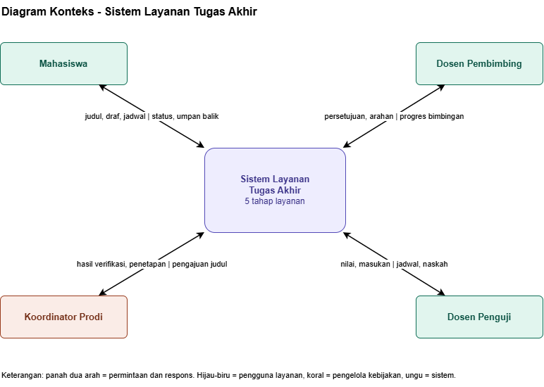
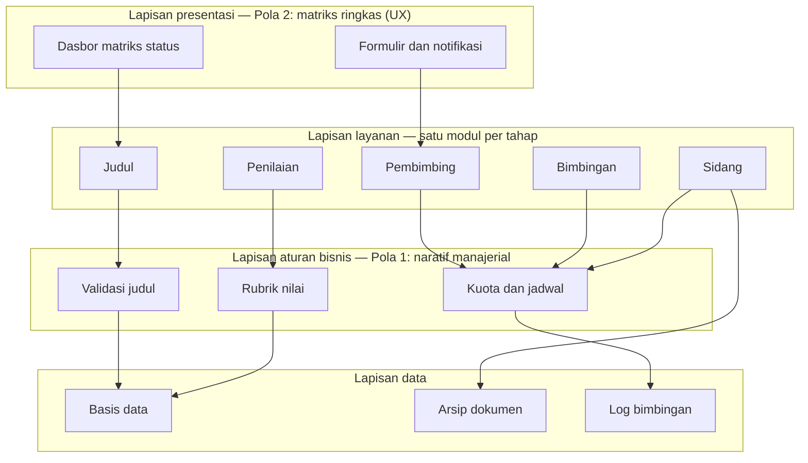
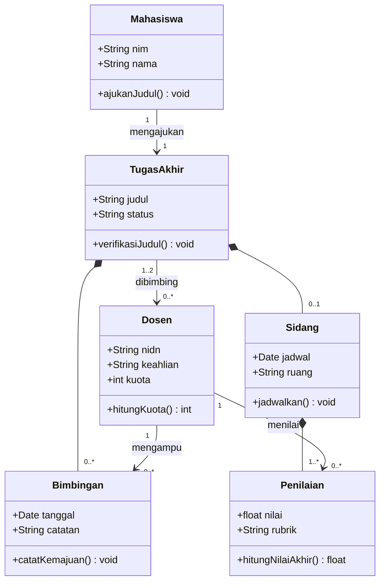

# U5. Desain Diagram

Dokumen ini mendokumentasikan desain diagram sistem **Layanan Tugas Akhir** (*Assignment & Assessment*) yang mencakup lima tahap layanan: pengajuan judul, penetapan pembimbing, bimbingan, seminar/sidang, dan penilaian. Desain digambarkan dari tiga sudut pandang:

1. **Diagram konteks** — batas sistem dan aktor yang berinteraksi dengannya.
2. **Arsitektur berlapis** — penerapan Pola 1 (naratif manajerial) dan Pola 2 (matriks ringkas) yang dianalisis pada `U4-pola.md`.
3. **UML class diagram** — struktur data dan relasi antar entitas layanan.

> Sumber diagram: berkas `layanan_tugas_akhir.drawio` (3 halaman). Gambar `layanan_tugas_akhir.drawio.png` adalah hasil ekspor halaman 1 (Diagram Konteks). Halaman 2 dan 3 disajikan ulang sebagai diagram Mermaid agar tetap dapat dibaca langsung di GitHub.

---

## 1. Diagram Konteks

Diagram konteks memperlihatkan sistem sebagai satu kotak tunggal beserta empat aktor yang bertukar data dengannya. Panah dua arah menandakan pertukaran **permintaan dan respons**.

**Tabel 1. Aktor dan pertukaran data pada diagram konteks**

| Aktor | Kategori | Masukan ke sistem | Keluaran dari sistem |
| :--- | :--- | :--- | :--- |
| **Mahasiswa** | Pengguna layanan | judul, draf, jadwal | status, umpan balik |
| **Dosen Pembimbing** | Pengguna layanan | persetujuan, arahan | progres bimbingan |
| **Koordinator Prodi** | Pengelola kebijakan | hasil verifikasi, penetapan | pengajuan judul |
| **Dosen Penguji** | Pengguna layanan | nilai, masukan | jadwal, naskah |

**Keterangan warna:** hijau-biru = pengguna layanan, koral = pengelola kebijakan, ungu = sistem.

**Catatan desain:**

- Sistem tidak menyimpan pengetahuan tentang mekanisme internal aktor; batas sistem hanya mengekspos lima tahap layanan.
- Koordinator Prodi dipisahkan dari pengguna layanan karena perannya sebagai pemilik kebijakan akademik (validasi judul, penetapan pembimbing), bukan sebagai pelaksana tahapan.
- Dosen berperan ganda (pembimbing dan penguji); pembedaan peran terjadi di dalam sistem, bukan pada diagram konteks.

---

## 2. Arsitektur Berlapis

Arsitektur disusun dalam empat lapisan dengan arah ketergantungan satu arah: lapisan atas bergantung pada lapisan di bawahnya, tidak sebaliknya. Pola hasil analisis `U4-pola.md` ditempatkan pada lapisan yang sesuai dengan sifatnya.

**Tabel 2. Peran setiap lapisan**

| Lapisan | Komponen | Peran | Pola terkait |
| :--- | :--- | :--- | :--- |
| **Presentasi** | Dasbor matriks status, formulir dan notifikasi | Menyajikan status tiap tahap secara ringkas dan konsisten | Pola 2 — matriks ringkas (UX) |
| **Layanan** | Modul Judul, Pembimbing, Bimbingan, Sidang, Penilaian | Satu modul per tahap layanan; menjadi satu-satunya pintu masuk ke aturan bisnis | — |
| **Aturan bisnis** | Validasi judul, kuota dan jadwal, rubrik nilai | Mengemas kebijakan akademik agar terisolasi dan mudah diubah | Pola 1 — naratif manajerial |
| **Data** | Basis data, arsip dokumen, log bimbingan | Persistensi data transaksi, berkas, dan jejak aktivitas | — |

**Catatan desain:**

- Pemisahan lapisan aturan bisnis dari presentasi dan data merupakan wujud taktik *split module / encapsulation* pada `U3-taktik.md`, sehingga perubahan kebijakan SKS atau rubrik tidak menyentuh UI maupun skema basis data.
- Modul layanan bersifat *stateless* dan memanggil aturan bisnis melalui antarmuka internal, sehingga tahap layanan dapat diuji dan diganti secara terpisah.

---

## 3. UML Class Diagram

Class diagram memodelkan entitas inti beserta relasinya. Belah ketupat terisi menandakan **komposisi** (bagian tidak berdiri sendiri tanpa induknya), sedangkan panah terbuka menandakan **asosiasi**.

**Tabel 3. Entitas dan relasi**

| Entitas | Atribut kunci | Operasi | Relasi |
| :--- | :--- | :--- | :--- |
| **Mahasiswa** | `nim`, `nama` | `ajukanJudul()` | 1 mahasiswa mengajukan 1 tugas akhir |
| **TugasAkhir** | `judul`, `status` | `verifikasiJudul()` | dibimbing 1..2 dosen; terdiri atas bimbingan dan sidang |
| **Dosen** | `nidn`, `keahlian`, `kuota` | `hitungKuota()` | mengampu banyak bimbingan; menilai banyak penilaian |
| **Bimbingan** | `tanggal`, `catatan` | `catatKemajuan()` | komposisi dari tugas akhir, diampu 1 dosen |
| **Sidang** | `jadwal`, `ruang` | `jadwalkan()` | komposisi dari tugas akhir, memiliki 1..* penilaian |
| **Penilaian** | `nilai`, `rubrik` | `hitungNilaiAkhir()` | komposisi dari sidang, diberikan oleh dosen penguji |

**Catatan desain:**

- `kuota` pada `Dosen` dan operasi `hitungKuota()` menjadi dasar aturan **kuota dan jadwal** di lapisan aturan bisnis, sekaligus menjaga beban pembimbingan tetap seimbang.
- `Penilaian` dibuat sebagai komposisi dari `Sidang`, bukan asosiasi bebas, agar nilai tidak dapat berdiri sendiri tanpa forum sidang yang sah.
- `status` pada `TugasAkhir` menjadi sumber data tunggal bagi dasbor matriks status di lapisan presentasi.

---

## 4. Keterkaitan dengan Dokumen Lain

| Dokumen | Keterkaitan dengan desain diagram |
| :--- | :--- |
| `U1-konteks-asr.md` | Aktor dan batas sistem pada diagram konteks mengikuti ruang lingkup *Assignment & Assessment*. |
| `U2-skenario-atribut-kualitas.md` | Lonjakan trafik pada pembukaan kuota sidang, proteksi berkas draf, dan perubahan aturan akademik menjadi alasan pemisahan lapisan. |
| `U3-taktik.md` | Antrean pesan dan *background worker* berada di lapisan layanan; JWT dan RBAC menjaga lapisan presentasi; *split module* diwujudkan oleh lapisan aturan bisnis. |
| `U4-pola.md` | Pola 2 (matriks ringkas) dipakai di lapisan presentasi, Pola 1 (naratif manajerial) dipakai di lapisan aturan bisnis. |
